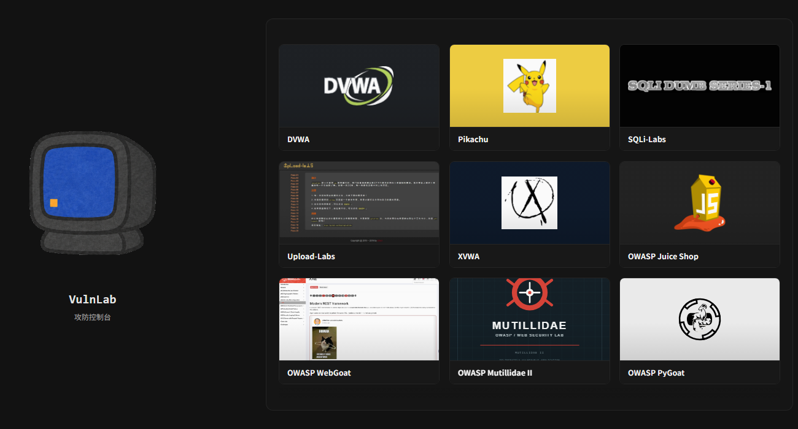
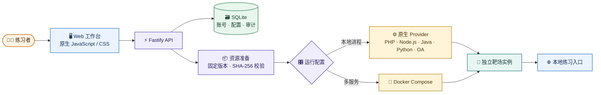
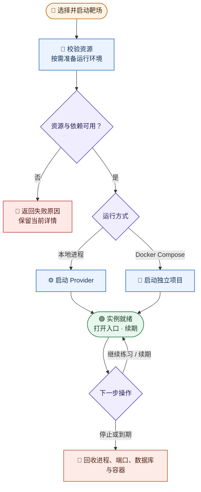

<!-- markdownlint-disable MD013 MD033 MD041 -->

<div align="center">
  
  <h1>攻防控制台</h1>
  <p><strong>网络攻防靶场管理系统</strong></p>
  <p>Windows x64 · 10 个常规靶场 + OA-Vuln-Labs · 独立实例</p>

  
  
  
  <a href="https://github.com/Chengxiaoyu1119/CTF-VulnLab/releases/latest"></a>
  <a href="https://github.com/Chengxiaoyu1119/CTF-VulnLab/actions/workflows/vulnlab-ci.yml"></a>
</div>

<p align="center">
  <a href="#快速开始">🚀 快速开始</a> ·
  <a href="#核心能力">✨ 核心能力</a> ·
  <a href="#支持的靶场">🎯 靶场目录</a> ·
  <a href="#系统结构">🧩 系统结构</a> ·
  <a href="#启动流程">🔄 启动流程</a> ·
  <a href="#文档">📚 文档</a>
</p>

<p align="center">
  
</p>
<p align="center"><sub>在同一工作台中启动、访问与管理本地靶场实例。</sub></p>

## 快速开始

```powershell
git clone https://github.com/Chengxiaoyu1119/CTF-VulnLab.git
cd CTF-VulnLab
powershell -ExecutionPolicy Bypass -File script/run_vulnlab.ps1
```

在 VS Code 按 `Ctrl+Shift+P`，运行 `Tasks: Run Task`（任务：运行任务），选择 `VulnLab: 启动`，即可通过同一启动流程运行项目。

打开 `http://127.0.0.1:6710/`，使用工作台默认账号 `vulnlab / vulnlab` 登录。选择靶场并启动；首次启动会按需准备运行资源。

## Windows 便携版

在 [GitHub Releases](https://github.com/Chengxiaoyu1119/CTF-VulnLab/releases) 下载 `CTF-VulnLab.zip`，解压后双击 `CTF-VulnLab\CTF-VulnLab.exe`。启动器会运行本地服务并打开浏览器；按 `Enter` 或 `Ctrl+C` 关闭服务。默认登录账号为 `vulnlab / vulnlab`。

便携包面向 Windows x64，已包含 Node.js、应用生产依赖和固定资源；靶场运行时会在首次使用时按需下载和校验。OA Docker 原版模式还需要本机 Docker Engine。运行数据库和下载的运行时保存在 `%LOCALAPPDATA%\CTF-VulnLab\data`，更新或删除程序目录不会自动清除这些数据。详细内容见包内 `发行说明.md`。

## 支持的靶场

| 靶场 | 训练方向 | 进入方式 |
| --- | --- | --- |
| [DVWA](https://github.com/digininja/DVWA) | 常见 Web 漏洞 | `admin / password` |
| [Pikachu](https://github.com/zhuifengshaonianhanlu/pikachu) | 中文漏洞练习 | `admin / 123456`、`pikachu / 000000`、`test / abc123` |
| [XSS-Labs](https://github.com/do0dl3/xss-labs) | XSS 反射与过滤绕过 | 首页直接进入 · 第 17–20 关使用本地 Ruffle |
| [SQLi-Labs](https://github.com/Audi-1/sqli-labs) | SQL 注入 | 首页直接进入；部分关卡含登录练习 |
| [Upload-Labs](https://github.com/c0ny1/upload-labs) | 文件上传 | 首页直接进入 |
| [XVWA](https://github.com/s4n7h0/xvwa) | 综合 Web 漏洞 | `admin / admin`、`xvwa / xvwa`、`user / vulnerable` |
| [OWASP Juice Shop](https://github.com/juice-shop/juice-shop) | 现代 Web 安全 | 直接进入；账户挑战需自行注册 |
| [OWASP WebGoat](https://github.com/WebGoat/WebGoat) | 课程式安全训练 | 创建账号并登录 |
| [OWASP Mutillidae II](https://github.com/webpwnized/mutillidae) | OWASP 漏洞练习 | 直接进入；登录练习按页面提示注册 |
| [OWASP PyGoat](https://github.com/adeyosemanputra/pygoat) | Django / OWASP | 注册并登录后进入课程 |
| OA-Vuln-Labs | 企业 OA · 25 个漏洞点 · 4 条攻击链 | 初始靶场账号 `admin / ZSD@admin2025!` |

## 核心能力

- 🎯 **统一训练目录：** 十个常规 Web 靶场与 OA-Vuln-Labs，按需准备运行资源。
- 🧩 **自定义导入：** 导入公开 GitHub/GitLab 仓库或本地 ZIP，并按运行模板校验。
- ⚙️ **独立实例：** 支持启动、访问、续期、停止与过期回收。
- 🐳 **多服务运行：** 支持 Docker Compose；OA-Vuln-Labs 可选本地模拟或 Docker 原版模式。

## 系统结构



## 启动流程



## 文档

| 文档 | 内容 |
| --- | --- |
| 📘 [开发与运行手册](src/README.md) | 配置、运行时与验证 |
| 🎨 [设计说明](DESIGN.md) | 界面与响应式规则 |
| 🖼️ [靶场封面来源](src/public/covers/README.md) | 图片来源与维护 |
| 🧪 [脚本索引](script/README.md) | 测试、smoke 与工具入口 |

<p align="center"><strong>如果这个项目对你有帮助，欢迎在 GitHub 上点亮一个 Star⭐。</strong></p>
